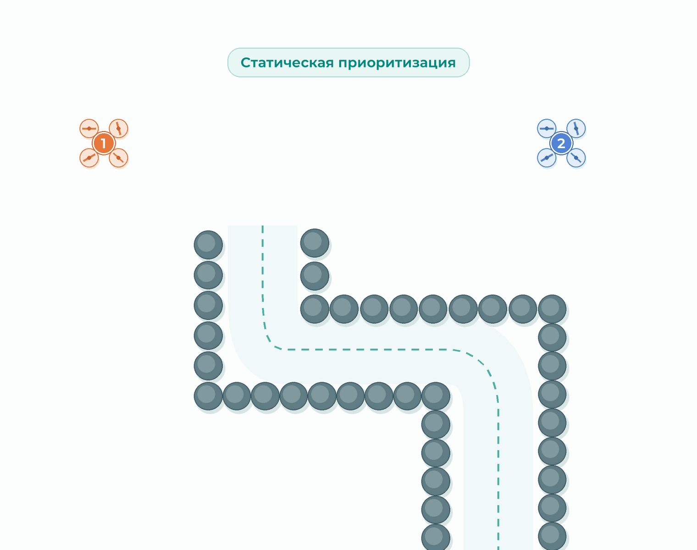
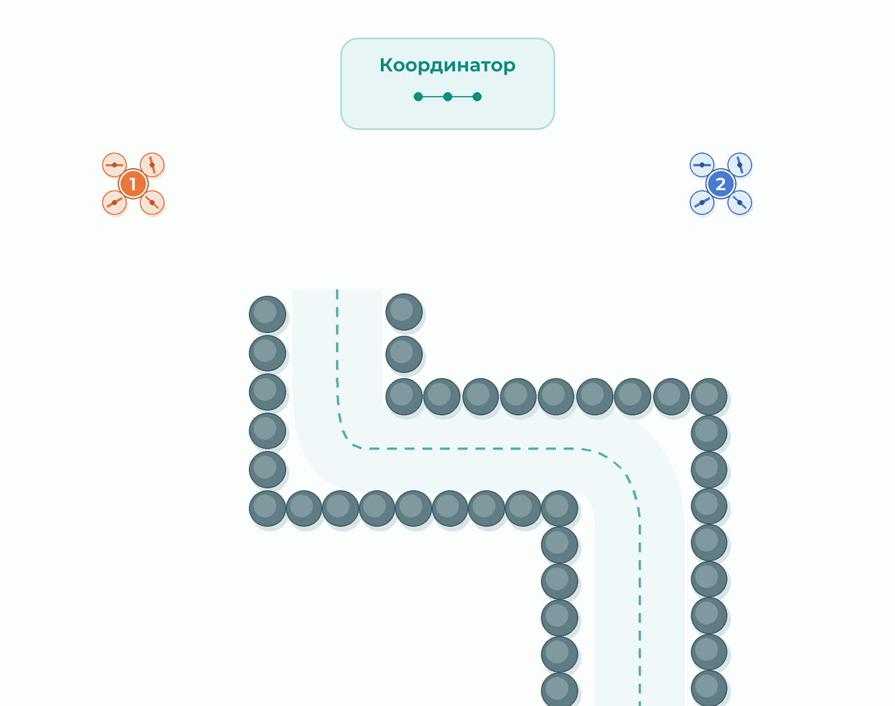

# QuadSwarm RL — приоритизация и масштабирование роя дронов

## Приоритизация

<p align="center">
  
  
</p>

<p align="center">
  
</p>

- **Статическая приоритизация.** При конфликте траекторий порядок уступания определяется номерами дронов.
- **Канал приоритета.** Во время обучения дроны обмениваются рангами с ближайшими соседями. На инференсе канал отключён, и каждый дрон сам решает, уступать ли, по локальным наблюдениям.
- **Центральный координатор.** При конфликте координатор сравнивает три варианта. Оба дрона продолжают полёт, уступает первый или уступает второй. Замороженная полётная сеть пересчитывает команды моторам для удержания позиции уступающего дрона.

## Результаты симуляции

### Приоритизация в коридорах

В таблице указана доля дронов, долетевших без столкновений. Для каждого размера роя использовали восемь коридоров по три сида. Во всех режимах работала одна замороженная полётная модель. [Протокол и исходные эпизоды](https://github.com/Vikvins/quad-swarm-rl/blob/swarm100/experiments/coordination-followup/scaling-100-300/README.md)

| Режим | 100 дронов | 200 дронов | 300 дронов |
|---|---:|---:|---:|
| Без приоритизации | 16,2% | 6,5% | 4,0% |
| Статическая приоритизация | 23,5% | 12,1% | 8,3% |
| Канал приоритета | 31,2% | 14,2% | 8,9% |
| Центральный координатор | **37,6%** | **20,5%** | **13,4%** |

### Масштабируемость на случайных препятствиях

Один чекпоинт обучили на 100 дронах и проверили на 16 сценах со случайными препятствиями. На каждую сцену и размер роя было по три повтора со штатными датчиками. Для больших роёв добавили высотные позиции для стартов и целей в той же комнате. Стандартное отклонение рассчитано между средними по сценам. [Протокол для 8–300 дронов](https://github.com/Vikvins/quad-swarm-rl/blob/swarm100/experiments/scaling-725m/random-obstacles/README.md)

| Дронов | Долетели без столкновений | Стандартное отклонение, п.п. |
|---:|---:|---:|
| 8 | 97,92% | 4,56 |
| 100 | 91,40% | 3,14 |
| 200 | 84,50% | 2,74 |
| 300 | 79,31% | 3,39 |
| 500 | 76,14% | 2,10 |
| 1 000 | 60,37% | 1,87 |

Весь рой долетел без столкновений в 41 из 48 эпизодов на 8 дронах и в 0 из 48 эпизодов на каждом большем размере.

## Структура репозитория

- Симулятор и сценарии — [`gym_art/quadrotor_multi/`](gym_art/quadrotor_multi/)
- Модели и конфигурации обучения — [`swarm_rl/models/`](swarm_rl/models/) и [`swarm_rl/runs/`](swarm_rl/runs/)
- Оценка на заданных сценах — [`swarm_rl/run_layout_suite.py`](swarm_rl/run_layout_suite.py)
- Веса, команды запуска и результаты — [эксперименты ветки `swarm100`](https://github.com/Vikvins/quad-swarm-rl/tree/swarm100/experiments)

## Установка и запуск

```bash
git clone https://github.com/Vikvins/quad-swarm-rl.git
cd quad-swarm-rl
conda create -n quad-swarm python=3.11.10
conda activate quad-swarm
python -m pip install -e .
```

Команда `bash train.sh` запускает пример обучения одного дрона. Для визуализации сохранённого прогона Sample Factory укажите каталог обучения и имя эксперимента в следующей команде.

```bash
python -m swarm_rl.enjoy \
  --algo=APPO --env=quadrotor_multi \
  --train_dir=PATH_TO_TRAIN_DIR --experiment=EXPERIMENT_NAME \
  --quads_render=True --quads_view_mode=global
```

Команды обучения и тестирования роя приведены в [списке экспериментов](https://github.com/Vikvins/quad-swarm-rl/tree/swarm100/experiments). Для запуска модульных тестов используйте `python -m unittest`.

## Исходная работа

Проект использует исходный симулятор QuadSwarm и его полётную политику. [Оригинальный репозиторий и список публикаций](https://github.com/Zhehui-Huang/quad-swarm-rl), [статья о симуляторе](https://arxiv.org/abs/2306.09537), [статья по навигации ICRA 2024](https://ieeexplore.ieee.org/document/10611499)
