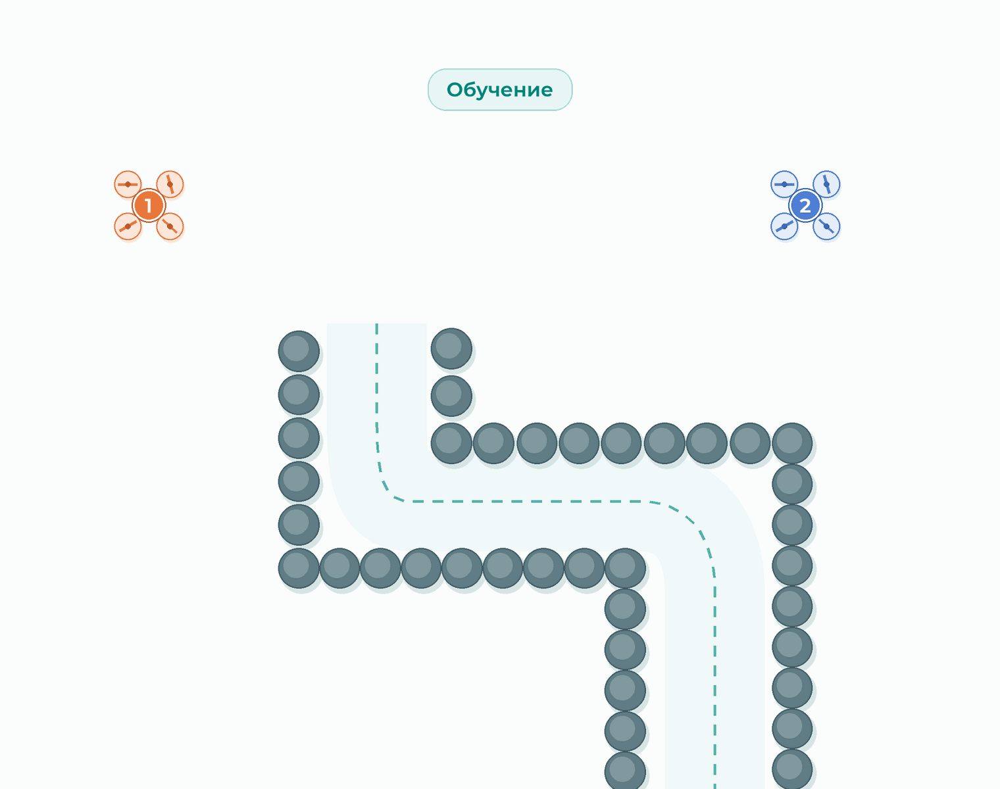

# QuadSwarm RL

This fork of QuadSwarm studies how quadrotor swarms share narrow passages, handle temporary obstacle sensor freezes, and transfer a learned flight policy to larger swarms. The experiments run in simulation.

## Priority coordination

| Static priority | Priority channel | Central coordinator |
| :---: | :---: | :---: |
|  |  |  |

- **Static priority.** Drone IDs determine which drone yields when paths conflict.
- **Priority channel.** Drones exchange priority scores with nearby neighbors during training. At inference, each drone decides whether to yield from its local observations with the channel disabled.
- **Central coordinator.** The coordinator forecasts conflicts and compares three options for a pair of drones. Both can continue, or either drone can yield. The flight policy turns a temporary hold target into motor commands.

## Simulation results

### Corridor navigation

Collision-free arrivals as a percentage of individual drones, measured across eight corridors and three seeds per corridor. All four modes used the same frozen flight policy. [Protocol and episode data](https://github.com/Vikvins/quad-swarm-rl/blob/swarm100/experiments/coordination-followup/scaling-100-300/README.md)

| Method | 100 drones | 200 drones | 300 drones |
|---|---:|---:|---:|
| No priority | 16.2% | 6.5% | 4.0% |
| Static priority | 23.5% | 12.1% | 8.3% |
| Priority channel | 31.2% | 14.2% | 8.9% |
| Central coordinator | **37.6%** | **20.5%** | **13.4%** |

### Scaling and sensor freezes

We evaluated one checkpoint trained on 100 drones across 16 random obstacle scenes with three repetitions per scene. For larger swarms, we added vertical slots for starts and goals within the same room. In the freeze tests, a quarter of the drones received their last obstacle readings for the duration of the freeze. [Sensor tests and episode data](https://github.com/Vikvins/quad-swarm-rl/blob/swarm100/experiments/scaling-725m/random-obstacles/README.md)

Each cell shows the mean percentage of drones that arrived without collisions, followed by the standard deviation across scene averages in percentage points.

| Drones | Normal sensor | 0.5 s sensor freeze | 2 s sensor freeze |
|---:|---:|---:|---:|
| 8 | 97.92% ± 4.56 | 97.92% ± 4.56 | 97.66% ± 4.56 |
| 100 | 91.40% ± 3.14 | 91.02% ± 3.48 | 90.35% ± 3.41 |
| 200 | 84.50% ± 2.74 | 84.46% ± 2.86 | 83.63% ± 2.87 |
| 300 | 79.31% ± 3.39 | 79.04% ± 3.35 | 78.57% ± 3.41 |
| 500 | 76.14% ± 2.10 | Not tested | Not tested |
| 1,000 | 60.37% ± 1.87 | Not tested | Not tested |

With normal sensors, all drones arrived without collisions in 41 of 48 episodes at 8 drones and 0 of 48 episodes at each larger size. At 100 to 300 drones, a 2-second freeze reduced collision-free arrivals by 3.22 to 5.25 percentage points among the affected drones.

## Repository layout

- Simulator and scenarios — [`gym_art/quadrotor_multi/`](gym_art/quadrotor_multi/)
- Flight policy models and training configurations — [`swarm_rl/models/`](swarm_rl/models/) and [`swarm_rl/runs/`](swarm_rl/runs/)
- Layout evaluation — [`swarm_rl/run_layout_suite.py`](swarm_rl/run_layout_suite.py)
- Checkpoints, experiment commands, and results — [`swarm100` experiments](https://github.com/Vikvins/quad-swarm-rl/tree/swarm100/experiments)

## Installation and use

```bash
git clone https://github.com/Vikvins/quad-swarm-rl.git
cd quad-swarm-rl
conda create -n quad-swarm python=3.11.10
conda activate quad-swarm
python -m pip install -e .
```

Start the single-drone training example with `bash train.sh`. To visualize a saved Sample Factory run:

```bash
python -m swarm_rl.enjoy \
  --algo=APPO --env=quadrotor_multi \
  --train_dir=PATH_TO_TRAIN_DIR --experiment=EXPERIMENT_NAME \
  --quads_render=True --quads_view_mode=global
```

For the swarm training and evaluation commands, see the [experiment index](https://github.com/Vikvins/quad-swarm-rl/tree/swarm100/experiments). Run unit tests with `python -m unittest`.

## Credits

This project builds on the original QuadSwarm simulator and its end-to-end flight policy. [Upstream repository and bibliography](https://github.com/Zhehui-Huang/quad-swarm-rl), [QuadSwarm simulator paper](https://arxiv.org/abs/2306.09537), [ICRA 2024 navigation paper](https://ieeexplore.ieee.org/document/10611499)
